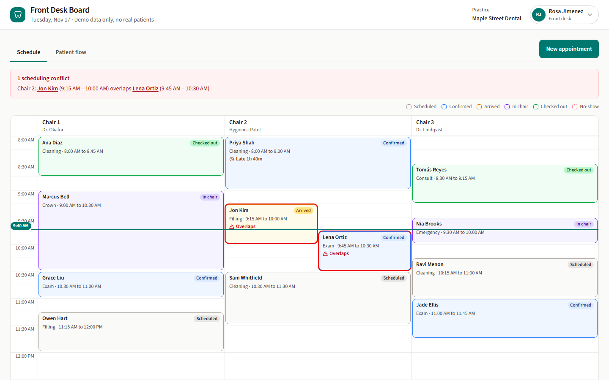
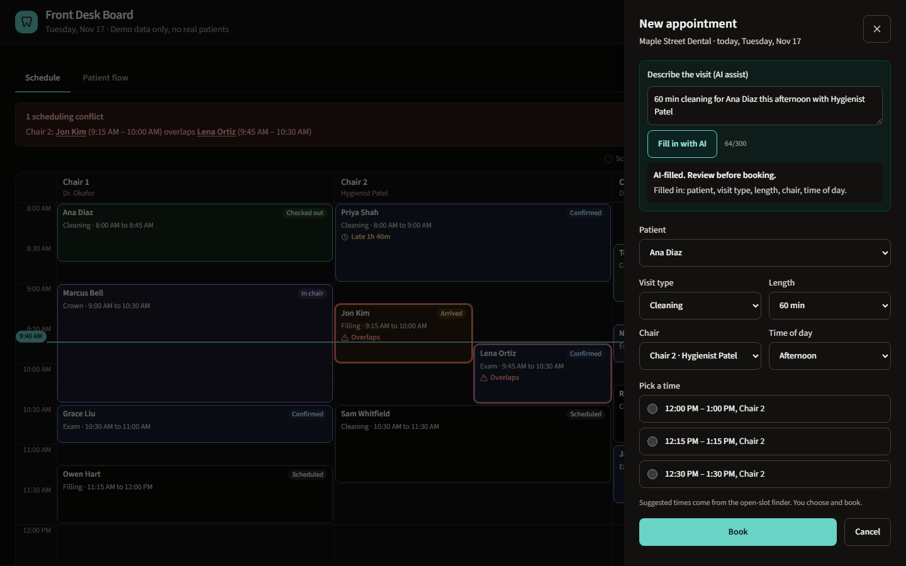
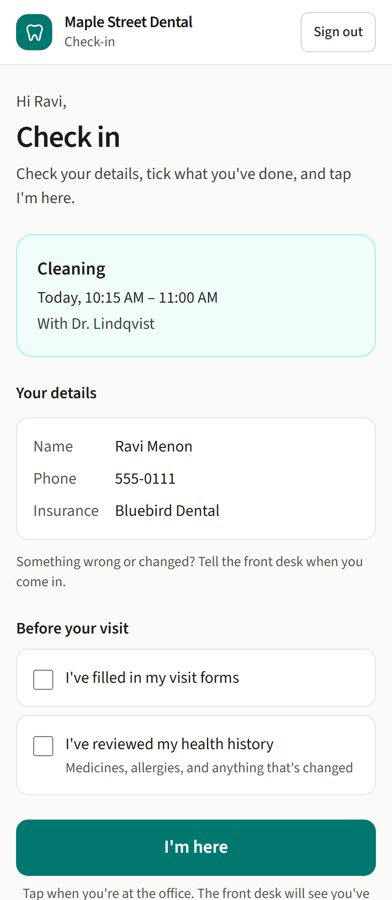
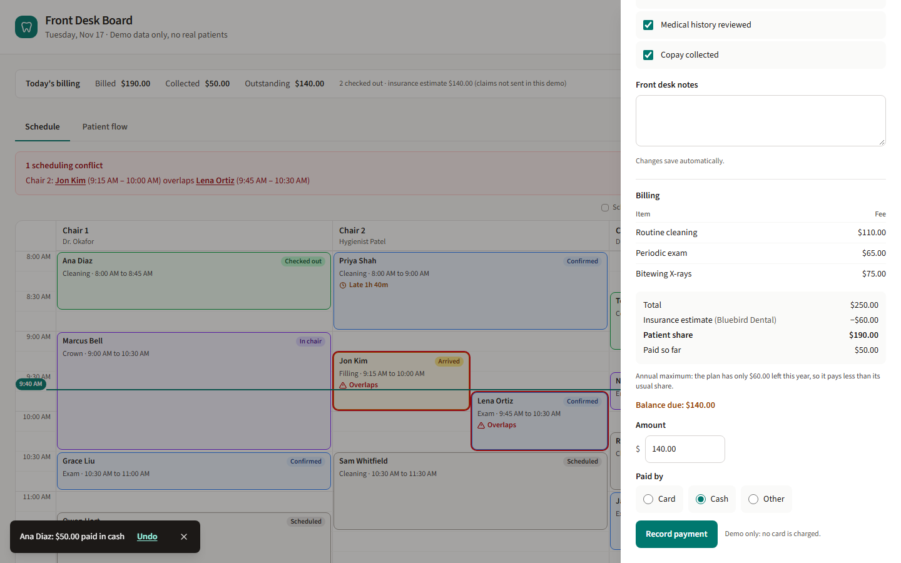
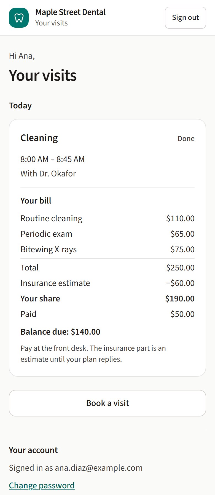
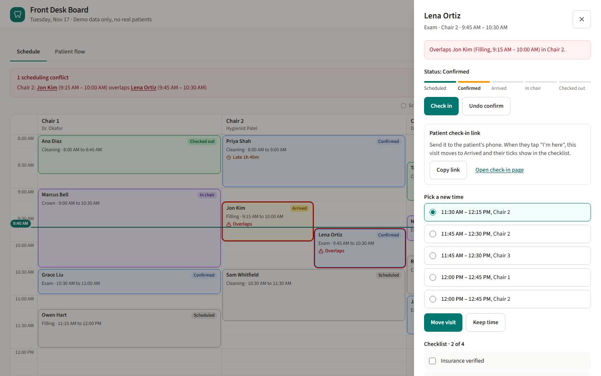
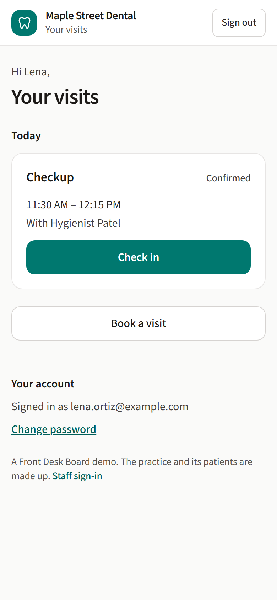
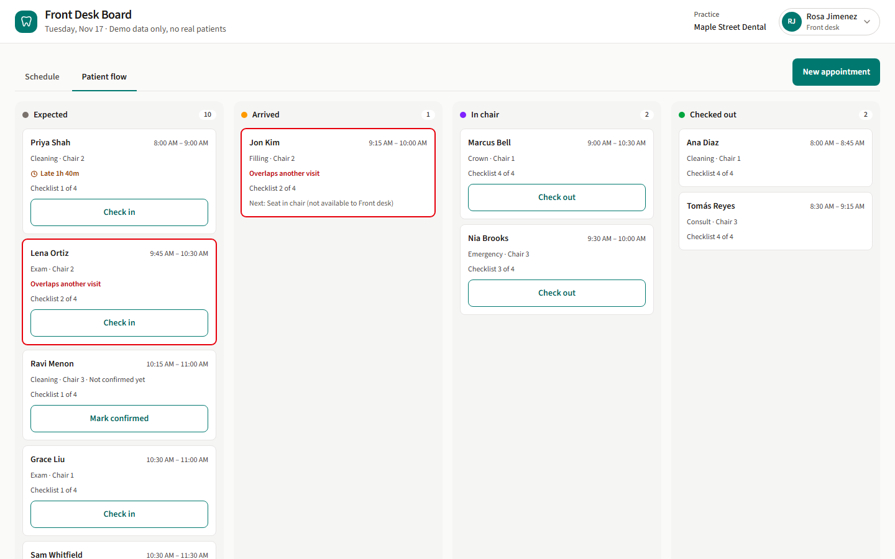
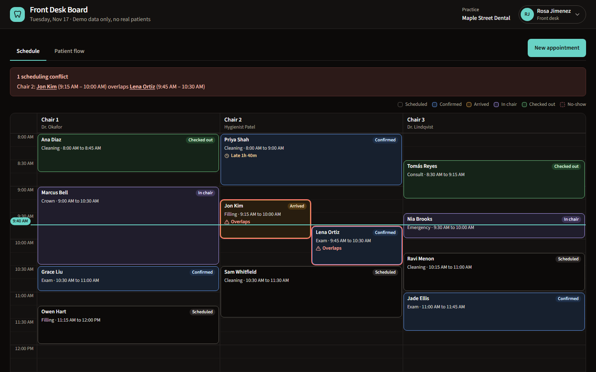

# Front Desk Board

A scheduling board for the front desk of a **fictional** dental office: chairs as
columns, patients moving from check-in to checkout, double-bookings flagged, and new
visits booked with an optional AI assist. Built with React, TypeScript, Tailwind and
TanStack Query, and tested with Vitest, Playwright and axe.

**[Live demo](https://front-desk-board.vercel.app/)** ·
[Architecture](docs/ARCHITECTURE.md) · [Design notes](NOTE.md) ·
[Guided tour](docs/TOUR.md) · [All features](docs/FEATURES.md)

> **Fake data only.** Every patient, practice and provider is invented, and phone
> numbers use the 555-01xx range reserved for fiction. Sign-in and the "server" are
> browser mocks; see [what's real and what's mocked](#whats-real-and-whats-mocked).

**Watch the 68-second demo** (captions, no sound needed):

https://github.com/user-attachments/assets/c285bfa1-15a6-41fa-a3ff-a8b539812881

## What it shows

- **Server state done properly.** TanStack Query with per-practice cache keys,
  mutations that invalidate and refetch, and Undo on every status change and move. A 409 is
  returned when someone else just took a time slot. Other open tabs update without a
  reload.
- **Rules as pure, tested functions.** The status workflow, role permissions, overlap
  detection and the open-slot finder live in `src/lib` with no React in them. They were
  built test-first, and the UI just renders their results.
- **AI with guardrails.** Claude turns a typed request into form fields, through a
  server route that keeps the API key off the browser. Code picks the open times, and a
  person books. An eval measures how accurate it is.
- **Checkout billing.** A checked-out visit shows its line items, an insurance
  estimate and the patient's share, with a pretend **Record payment** and Undo. The
  estimate is a pure function in integer cents with a tested rounding rule. The
  patient sees their own bill, read only, on "Your visits". Fees and
  plans are made up, nothing is charged, and claims aren't built
  ([what's mocked](docs/WHAT-IS-MOCKED.md)).
- **Roles and multiple practices.** Front desk, provider and office manager each see
  only the actions they're allowed. Data is scoped per practice, and only the office
  manager can switch practices.
- **A patient side on the same rules.** Patients book online and check in from their
  phone, with times from the same slot finder and the same double-booking check. A
  check-in shows up live on the desk's board. Patients see only their own visits, and
  someone else's check-in link reads "not found", the same as a link that doesn't exist.
- **Accessibility built in.** Dialogs trap and return focus, tabs follow the ARIA
  pattern, and changes are announced. axe runs on every screen in both themes, in CI.

## Try it in a minute

1. Open the **[live demo](https://front-desk-board.vercel.app/)** and sign in as
   **Rosa Jimenez** (front desk). There's no password; you pick a user.
2. Click **Lena Ortiz**, one of the two visits in the red double-booking banner, then
   **Check in**. Undo is in the toast.
3. Click **New appointment**, type "60 min cleaning for Ana Diaz this afternoon with
   Hygienist Patel", and press **Fill in with AI**. Then pick a time and book.
4. In a second tab, book as a patient at [/book](https://front-desk-board.vercel.app/book)
   (`grace.liu@example.com`, password `demo1234`). The visit appears on the board in
   the first tab.

The [guided tour](docs/TOUR.md) covers roles, cancelling, no-shows, patient check-in
from a phone, and the error states, and lists every [demo patient login](docs/TOUR.md).

  
  

_Left: the AI assist fills in the form, and the slot finder offers times. Right: a patient checks in from their phone._

  
  

_Left: checkout billing in the drawer, with what's still due beside Copay collected and the office manager's day totals behind it. Right: the patient sees the same bill, read only. Fees, plans and payments are made up._

  
  

_Left: Move to… sits under the double-booking it fixes and offers the patient's own provider first, naming any other. Right: the patient's page shows the new time without a reload._

| Patient flow                                                                                                 | Dark mode                                                |
| ------------------------------------------------------------------------------------------------------------ | -------------------------------------------------------- |
|  |  |

## Decisions

- **TanStack Query, not Redux.** Nearly all of the state is server data, so it lives in
  the query cache. UI state, such as which drawer is open, holds only ids.
- **No UI library.** The dialog, tabs and toast are hand-built and tested, to show the
  accessibility work. In production I'd use headless primitives (Radix or React Aria).
- **No router package.** There are only a few pages, so a small path switch
  (`src/lib/route.ts`) is enough.
- **No memoization yet.** I measured first: the board renders in about 60 ms and
  nothing re-renders in a loop, so `memo` would add code without a gain. See
  [Performance](docs/PERFORMANCE.md).
- **The AI only fills the form.** Picking a time is deterministic code
  (`findOpenSlots`), and a person always books. See [AI booking assist](docs/AI-ASSIST.md).
- **Wall-clock times, no `Date`.** Times are the practice's local strings, so results
  don't change with the viewer's timezone, and the demo clock is fixed for repeatable
  demos.

## What's real and what's mocked

- **Real:** the React app, the data layer, the workflow and permission rules, the
  tests, and two server routes. The AI route calls Claude with the key in a server
  environment variable. The patient sign-in route limits tries per IP.
- **Mocked:** the API is an in-browser mock stored in `localStorage`, shared between
  tabs, with fake latency and switchable failures. Staff sign-in is "pick a user".
  Patient accounts, passwords and sessions model a real server's rules but run in the
  browser, so **they are not security**. Role permissions only hide buttons; a real
  server would enforce them on every request. Fees and insurance plans are made up,
  and payments are pretend: nothing is charged and no claim is sent.

The details, and what a real system would do instead, are in
[What is mocked](docs/WHAT-IS-MOCKED.md).

## Quality

- **632 unit and component tests** (Vitest and React Testing Library). The logic was
  built test-first, each feature as a failing-tests commit followed by the code.
- **End-to-end tests** (Playwright): booking, check-in, the double-booking banner, the
  AI assist with its route faked (so CI never calls Claude), live updates between tabs,
  moving a visit out of a double-booking, recording a payment at checkout, and the
  patient pages.
- **Accessibility:** axe (WCAG 2.2 AA rules) on every screen, at desktop and phone width.
  Lighthouse gives Accessibility, Best Practices and SEO 100 on every screen tested, on
  phone and desktop; Performance is 96–100 (scores in [Performance](docs/PERFORMANCE.md#lighthouse)).
  CI holds the first three at 100 on 25 pages and board states, light and dark.
- **CI** runs typecheck, lint, format check, unit tests, build, e2e and Lighthouse on
  every push.

## What I'd do next

- Protect the AI endpoint per signed-in user, not just per IP.
- Grow the AI eval from 15 hand-written cases to 50+ from real phrasing, and run it in CI.
- Push changes from a real server over WebSocket or SSE, instead of syncing between tabs.
- Add a `version` to each appointment, so conflicting edits get a 409 instead of
  last-write-wins.
- Billing past checkout: claims and ERA/EOB posting, a payment processor, statements,
  payment plans and a running patient ledger.

More in [docs/NEXT.md](docs/NEXT.md).

## Run it

Requires Node 24 (see `.nvmrc`).

    npm install
    npm run dev

    npm run check   # typecheck, lint, format check, unit tests
    npm run build
    npm run e2e     # Playwright: user flows and axe accessibility checks
    npm run lighthouse  # after build: Lighthouse must give 100 (needs Chrome)

The first e2e run needs a browser: `npx playwright install chromium`. The AI assist
needs `ANTHROPIC_API_KEY` in `.env.local` (see `.env.example`). Without it, the panel
says so and the form still works.

Code map: [Where things are](docs/ARCHITECTURE.md#where-things-are).
