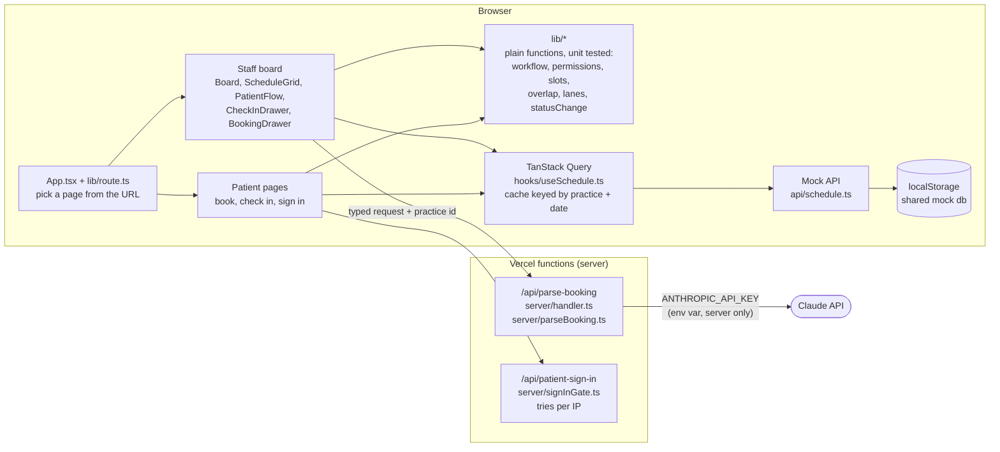
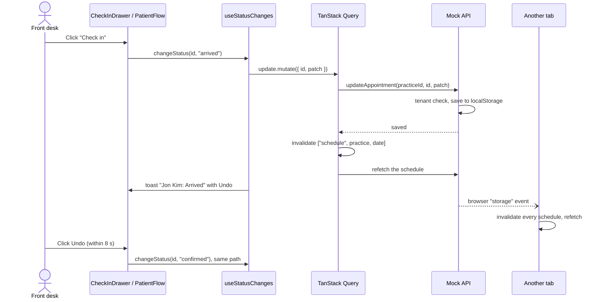
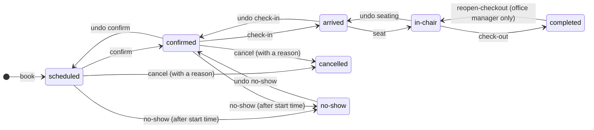
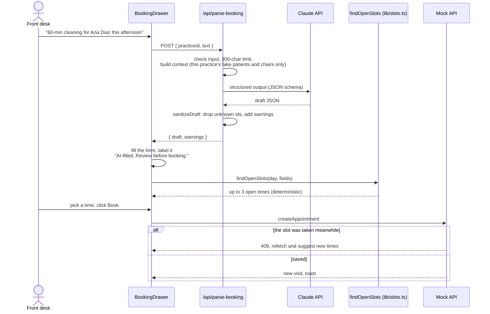

# How the front desk board fits together

Four diagrams, from the big picture down to one feature. GitHub draws them;
in VS Code, install "Markdown Preview Mermaid Support" to see them in the preview.

1. [The big picture](#1-the-big-picture): browser, mock data, and the two server routes
2. [A status change](#2-a-status-change-check-in-undo-other-tabs): save, refetch, toast, undo, other tabs
3. [The visit workflow](#3-the-visit-workflow): statuses, and which role may move a visit
4. [AI booking](#4-ai-booking-ai-fills-the-form-code-picks-the-times-a-person-books): AI fills the form, code picks the times, a person books

## 1. The big picture

Everything runs in the browser except two small Vercel functions. The "API" is a
mock that keeps its data in `localStorage`, so every tab of the site shares it.

What to say about it:

- **Components stay thin.** Rules live in `lib/` as plain functions, so they're
  tested without rendering anything.
- **Server data lives in the query cache, not in React state.** UI state holds ids
  (which drawer is open); the data comes from TanStack Query.
- **The API key never reaches the browser.** The browser calls our own route,
  and only that route talks to Claude.

## 2. A status change (check in, undo, other tabs)

Every status change, whether from the drawer, the flow board or the toast's
Undo, goes through one function: `changeStatus` in `hooks/useStatusChanges.ts`.

If the save fails, the mutation's error shows as an alert, and nothing on screen
changes because the cache was never edited by hand.

## 3. The visit workflow

The happy path runs left to right. Each arrow names the permission a role needs
(`lib/permissions.ts`). The "back" arrows are the undo steps
(`previousAction` in `lib/workflow.ts`).

Who holds each permission:

| Permission                            | Front desk | Provider | Office manager |
| ------------------------------------- | :--------: | :------: | :------------: |
| confirm, check-in, check-out          |     ✓      |          |       ✓        |
| seat                                  |            |    ✓     |       ✓        |
| reopen-checkout                       |            |          |       ✓        |
| edit-checklist, book, cancel, no-show |     ✓      |          |       ✓        |
| switch-practice                       |            |          |       ✓        |

These hide buttons a role can't use. They are not security: a real server would
check the same table on every request.

## 4. AI booking: AI fills the form, code picks the times, a person books

The AI's job is narrow: turn one typed sentence into form fields. It never
chooses a time and never books.

Failure paths: there's no API key (503), Claude refuses (422), Claude errors (502),
or Vercel's rate limit applies (429). Each shows a message, and the form still
works by hand.

## Where things are

- `src/App.tsx`: signed in or not, inside an error boundary
- `src/components/Board.tsx`: the signed-in screen (state and layout); `BoardHeader`,
  `ScheduleGrid`, `PatientFlow`, `CheckInDrawer`, `BookingDrawer` beside it
- `src/hooks/`: `useStatusChanges` (save, toast, Undo), `useBooking`, `useSchedule`
  (TanStack Query), `useTheme`, `useMediaQuery`, `useModalDialog`
- `src/components/patient/`: the patient pages (`ChoosePracticePage`, `BookVisitPage`,
  `PatientHomePage`, `PatientSignUpPage`, `CheckInPage`, `ChangePasswordPage`, and
  `PasswordResetPages`: forgot password, demo inbox, new password), the sign-in gate and form (`RequirePatient`, with
  `usePatientSession` and `src/session/patientStorage.ts`), and
  their frame (`PatientShell`); `src/lib/route.ts` picks the page from the URL path (no
  router package; `vercel.json` sends `/book`, `/patient` and `/check-in` paths to
  `index.html`);
  `CheckInLink` is the link section in the check-in drawer
- `src/lib/`: the rules as pure, tested functions: `statusChange` (kinds, Undo, toast
  text), `workflow` (next step, cancel, no-show, lateness), `slots` (open-slot finder),
  `patientBooking` (which times a patient sees),
  `overlap`, `lanes`, `permissions`, `assist` (AI answer checks), `time`
- `src/api/schedule.ts`: the mock server (shared between tabs through `localStorage`);
  `src/api/patientPortal.ts`: its patient side (sign-up, sign-in, password reset and change, sessions, and calls that
  only return or change the signed-in patient's own visits), with the demo logins in
  `src/mocks/patientLogins.ts`;
  `server/` and `api/`: the AI route and the patient sign-in route
  (`api/patient-sign-in.ts`, `server/signInGate.ts`; the browser side is
  `src/api/signInGate.ts`)
- `e2e/`: Playwright flows and axe checks; `evals/`: the AI eval
