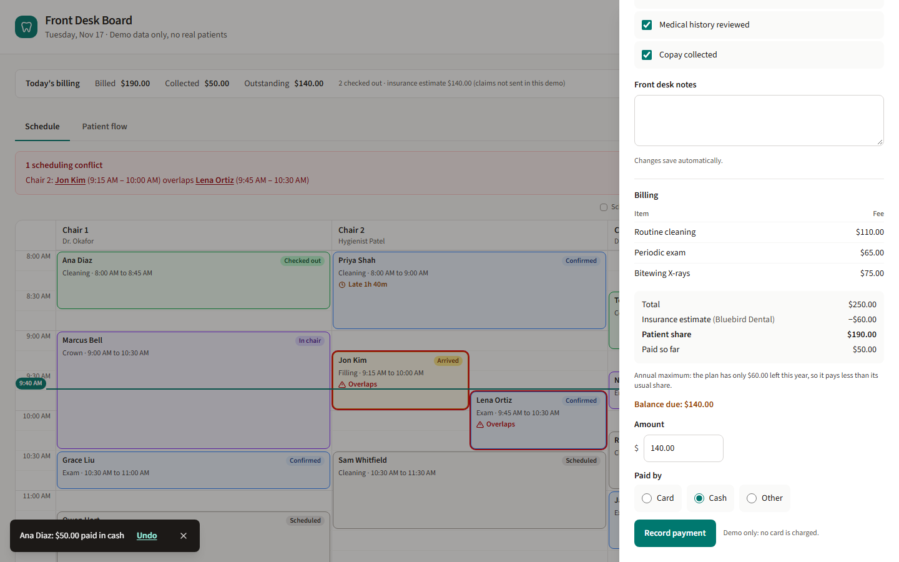
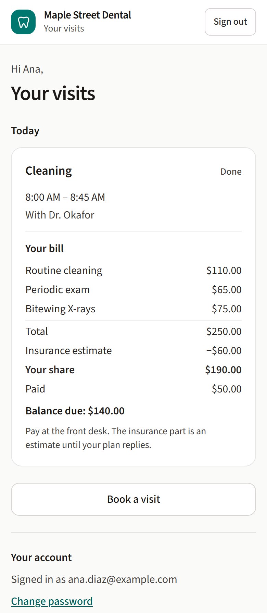

# A guided tour of the demo

Everything here is fake data. Live demo: https://front-desk-board.vercel.app/ ([back to the README](../README.md))

1. Sign in as **Rosa Jimenez** (front desk). No password; pick a user.
2. The red banner is a deliberate double-booking in Chair 2. Click **Lena Ortiz** to
   open the check-in drawer, then **Check in**. Undo is in the toast. **Priya Shah**
   (8:00) never arrived: open her and **Mark no-show**. Or fix the double-booking
   instead: open Lena, press **Move to…**, pick **11:30 AM, Chair 2**, and **Move
   visit**. The banner clears, and Undo in the toast puts her back.
3. Billing at checkout: open **Ana Diaz** (8:00, checked out). The drawer's
   **Billing** section lists her cleaning's line items, the insurance estimate (her
   plan has only $60.00 left this year) and her $190.00 share. Enter 50, choose
   **Cash**, and **Record payment**: the balance drops to $140.00, Copay collected
   ticks itself, and the toast offers Undo. It's pretend: nothing is charged.
   **Tomás Reyes** (checked out) owes nothing; his plan pays the consult in full.
   In a second tab, sign in at [/patient](https://front-desk-board.vercel.app/patient)
   as `ana.diaz@example.com` (`demo1234`): her visit shows **Your bill**, read only,
   and the balance updates when the desk records a payment.

   

     
     
   

   _Left: the drawer after recording $50.00 in cash (shown as Theo Grant, so the day's
   totals are visible behind it). Right: Ana's own bill on her phone._

4. Click an empty spot on the schedule, or **New appointment**, to book. In the panel,
   type "60 min cleaning for Ana Diaz this afternoon with Hygienist Patel" and press
   **Fill in with AI**, then pick a time.
5. Open the account menu (top right) to switch between light and dark, and sign out. Sign in as **Theo Grant** (office
   manager) to switch practices and see **Today's billing** (billed, collected,
   outstanding), or **Dr. Amara Okafor** (provider), who can seat a
   patient but can't book, check in, move or cancel.
6. The patient's side: keep the board open and, in a second tab, open
   [/book](https://front-desk-board.vercel.app/book) (also linked from the sign-in
   page) and choose **Maple Street Dental**. Sign in as a patient
   (`grace.liu@example.com`, password `demo1234`), then pick a visit type and a time,
   and book. The visit appears
   on the board in the first tab, as Scheduled, without a reload. **Reset demo data** in
   the account menu starts over.
7. Patient check-in: on the board, open **Ravi Menon** (10:15) and press **Open
   check-in page** (or **Copy link**). The link alone shows nothing: sign in as Ravi
   (`ravi.menon@example.com`, `demo1234`), tick "I've filled in my visit forms", and
   tap **I'm here**. Back on the board, Ravi is Arrived and his checklist
   shows Forms complete.
8. Patient sign-in: open [/patient](https://front-desk-board.vercel.app/patient)
   (also linked from the sign-in page) and sign in as `owen.hart@example.com`,
   password `demo1234`. "Your visits" lists today's visit with a **Check in** link and
   a **Book a visit** button. Now open Ravi's link, `/check-in/maple/a-11`: Owen gets
   "We couldn't find that visit", because it isn't his.
9. Patient sign-up: on the patient sign-in page, choose **Create an account**
   ([/patient/sign-up](https://front-desk-board.vercel.app/patient/sign-up)), pick an
   office, and enter a made-up name, phone, `@example.com` email, and a password of 8+
   characters. You land on "Your visits", signed in, and can book. The new patient
   also shows in the board's New appointment patient list.
10. Forgot password: on the patient sign-in form, choose **Forgot password?**, enter
    `owen.hart@example.com`, then open the
    [demo inbox](https://front-desk-board.vercel.app/patient/demo-inbox) and the reset
    link in it. Choose a new password; `demo1234` stops working for Owen and the new
    one works. **Reset demo data** puts `demo1234` back.
11. Change password: signed in as a patient, scroll to **Your account** on "Your
    visits" and choose **Change password**. Enter the current password and a new one
    twice.

Demo patient logins: every made-up patient's email is `first.last@example.com`
(accents dropped, so Tomás Reyes is `tomas.reyes@example.com`), all with the password
`demo1234`. For example: `owen.hart@example.com` and `ravi.menon@example.com` (Maple
Street, both expected today), `ana.diaz@example.com` (Maple Street, visit done, with a bill),
`kofi.mensah@example.com` (Riverbend).

The AI assist is rate limited (10 requests a minute per visitor). Add `?fail`,
`?failBook`, or `?crash` to the URL to see the error states.
